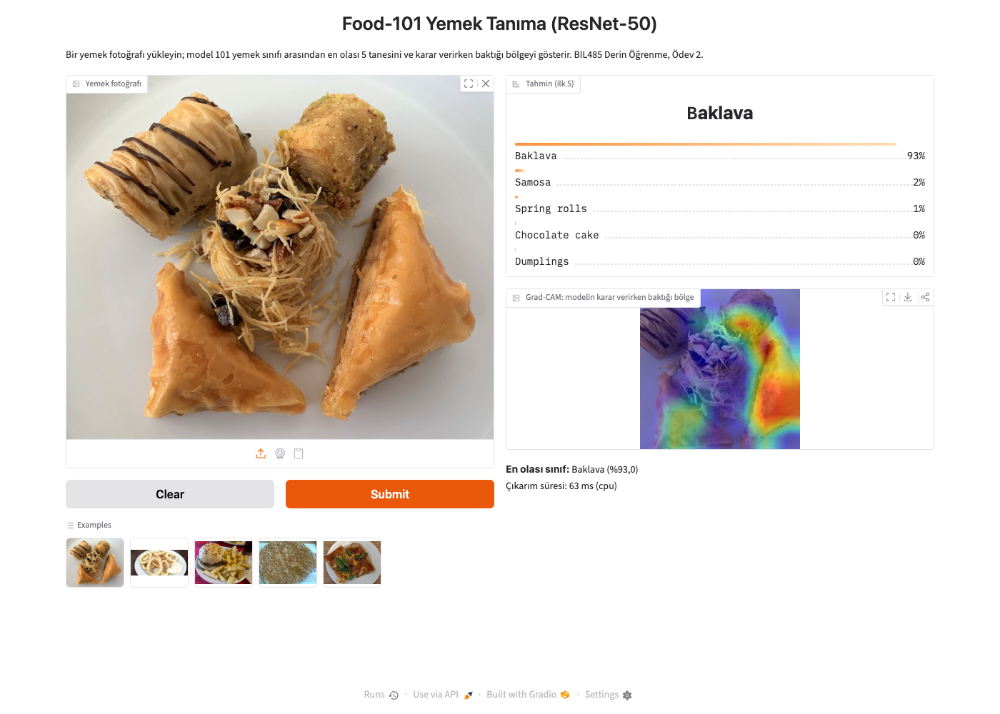

# BIL485 Derin Öğrenme, Ödev 2: Computer Vision

**Food-101 ile yemek fotoğrafı sınıflandırma: sıfırdan CNN ve ResNet-50 transfer learning**

Bir yemek fotoğrafını 101 yemek sınıfından birine atayan bir model, onu kullanan bir Gradio web uygulaması ve Food-101 dışından
gerçek dünya fotoğrafları üzerinde değerlendirme.

[](https://colab.research.google.com/github/uuu4/bil485-cv-food101/blob/main/food101_cnn.ipynb)

## Özet

| | |
|---|---|
| Görev | Görüntü sınıflandırma (101 sınıf) |
| Veri seti | [Food-101](https://data.vision.ee.ethz.ch/cvl/datasets_extra/food-101/): 101 000 görüntü. Train 68 175 / validation 7 575 (resmî train'den, tabakalı) / test 25 250 (resmî test) |
| Modeller | Sıfırdan eğitilen 4 bloklu CNN (temel çizgi) ve ImageNet ağırlıklı ResNet-50, ince ayar |
| Seçim | Yalnız validation doğruluğu; test kümesi seçimden sonra bir kez ölçülür |
| Metrikler | Accuracy, top-5 accuracy, macro precision / recall / F1, karışıklık matrisi, çıkarım süresi |
| Uygulama | Gradio (`app.py`): fotoğraf yükleme veya kamera, ilk 5 tahmin, Grad-CAM ısı haritası, düşük güven uyarısı |
| Rapor | [`REPORT.md`](REPORT.md): ödev belgesinin 9. bölümündeki tablo, `results/results.json`'dan otomatik üretilir |

## Dosyalar

| Dosya / klasör | İçerik |
|---|---|
| `food101_cnn.ipynb` | Tüm deney: veri ve bölme, iki modelin eğitimi, seçim, test, hata analizi, çıkarım süresi, gerçek dünya fotoğrafları, uygulama, rapor |
| `food_cv.py` | Notebook ve uygulamanın ortak kodu: veri, modeller, eğitim döngüsü, metrikler, Grad-CAM, checkpoint, rapor |
| `app.py` | Gradio web uygulaması |
| `my_photos/` | Food-101 dışından 5 gerçek dünya fotoğrafı (Wikimedia Commons, açık lisanslı; [kaynaklar](my_photos/SOURCES.md)); dosya adı gerçek etiket ([kural](my_photos/README.md)) |
| `results/` | Notebook çıktıları: `results.json` (tüm ham sonuçlar), eğriler, karışıklık matrisi, hatalı örnekler, gerçek dünya fotoğrafı tahminleri |
| `checkpoints/` | İki modelin ağırlıkları (fp16): `resnet50_food101.pt` (uygulamanın kullandığı), `smallcnn_food101.pt` |
| `tests/smoke_test.py` | Food-101 indirmeden, sahte küçük veriyle tüm akışı CPU'da sınayan test |
| `tools/modal_run.py` | Notebook'u Modal'da (GPU) papermill ile çalıştıran betik; bu sonuçlar onunla üretildi |
| `logs/modal_full_run.log` | Tam koşunun hücre hücre çıktısı |

## Çalıştırma

**Deney (Colab, GPU):** yukarıdaki *Open in Colab* bağlantısı → *Çalışma zamanı → Çalışma zamanı türünü değiştir → GPU* →
*Tümünü çalıştır*. İlk hücre repoyu klonlar ve eksik paketleri kurar. T4'te toplam yaklaşık 1–1,5 saat. Oturum düşme riskine karşı
`USE_DRIVE = True` yapılırsa checkpoint'ler Drive'a yazılır ve yeniden çalıştırmada eğitim atlanır. Akışı birkaç dakikada denemek için
`QUICK_RUN = True`.

**Uygulama (yerel):**

```bash
pip install -r requirements.txt
python app.py            # http://127.0.0.1:7860
python app.py --share    # geçici herkese açık bağlantı
```

**Test:** `python tests/smoke_test.py`

## Sonuçlar

Notebook Modal'da (NVIDIA L4, 8 vCPU) baştan sona çalıştırıldı; çıktılar notebook'un içinde, ayrıntı [`REPORT.md`](REPORT.md) ve
notebook §12'de.

| Model | Validation acc | Test acc | Test top-5 | Test macro F1 | Eğitim süresi |
|---|---|---|---|---|---|
| Sıfırdan CNN (4 blok, 1,2 M parametre) | %48,1 | %52,3 | %80,3 | %50,9 | 4,2 dk |
| **ResNet-50 transfer learning (seçilen)** | %82,6 | **%87,0** | %97,4 | %86,9 | 14,6 dk |

Food-101 dışından 5 gerçek dünya fotoğrafı: Food-101'de olan 4 yemeğin 3'ü doğru (baklava %93, hamburger %56, pizza %49); kalamar
tava "onion rings" sanıldı (doğru sınıf 2. sırada); Food-101'de olmayan lahmacun en yakın sınıf olan pizza'ya atandı (%63).



## Kaynaklar

- L. Bossard, M. Guillaumin, L. Van Gool. *Food-101: Mining Discriminative Components with Random Forests.* ECCV 2014.
- K. He, X. Zhang, S. Ren, J. Sun. *Deep Residual Learning for Image Recognition.* CVPR 2016.
- R. R. Selvaraju ve ark. *Grad-CAM: Visual Explanations from Deep Networks via Gradient-based Localization.* ICCV 2017.
